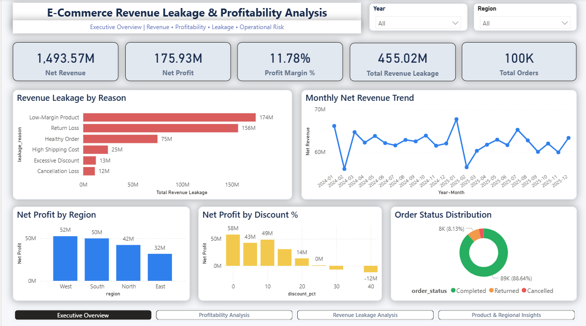
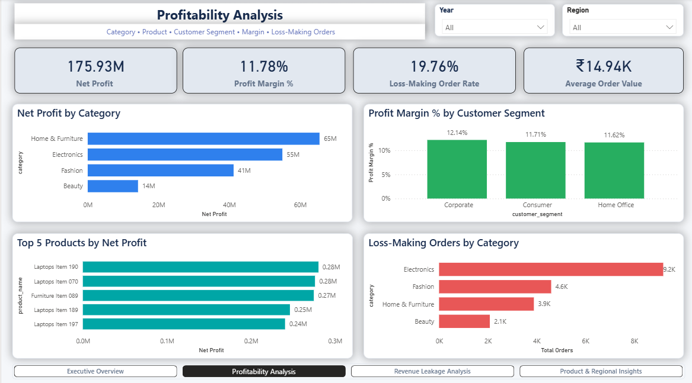
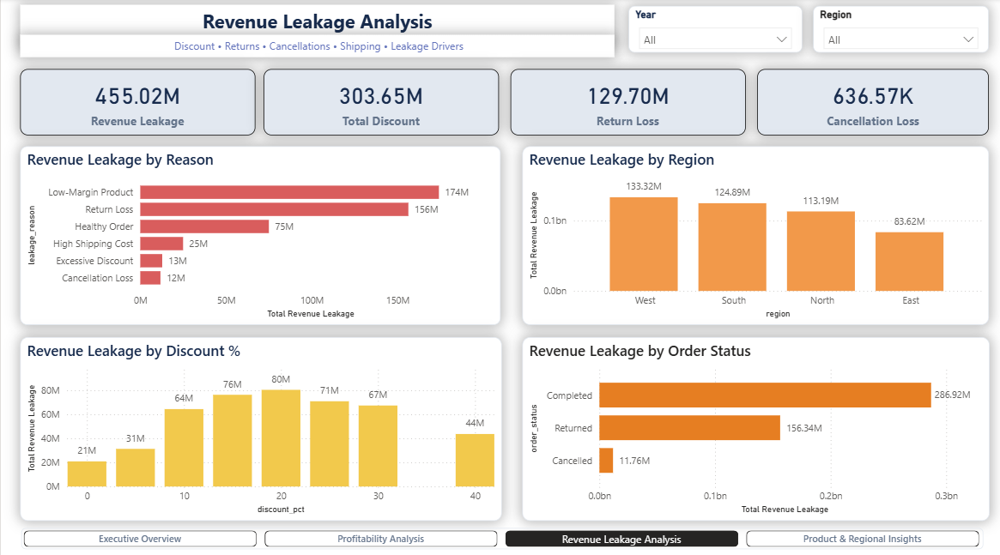
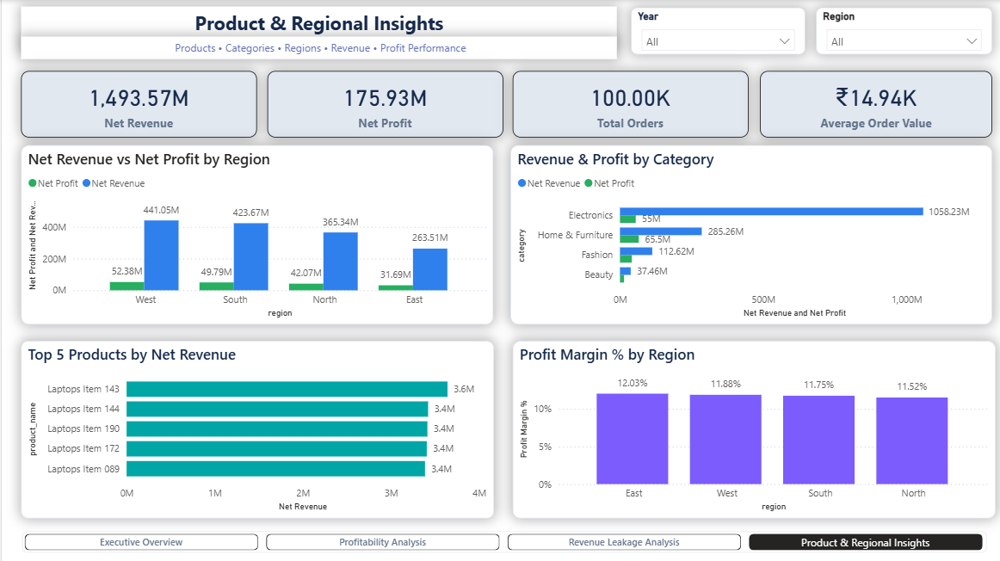

# E-Commerce Revenue Leakage & Profitability Analysis

An end-to-end data analytics project designed to identify revenue leakage, profitability drivers, loss-making transactions, discount impact, return losses, cancellation losses, and regional/product performance across 100,000 e-commerce orders.

The project combines **Python, PostgreSQL, SQL, Excel, and Power BI** to transform transactional data into actionable business insights and an interactive executive dashboard.

---

## Project Overview

E-commerce businesses can generate strong sales while still losing substantial revenue through excessive discounts, product returns, cancellations, high shipping costs, and low-margin products.

This project analyzes transaction-level e-commerce data to answer questions such as:

- How much revenue is being lost?
- What are the biggest causes of revenue leakage?
- Which categories and products generate the most revenue and profit?
- Which products generate high revenue but weak margins?
- How do discounts affect profitability?
- Which regions perform best?
- How significant are return and cancellation losses?
- Which orders/products are loss-making?

---

## Key KPIs

| KPI | Value |
|---|---:|
| Total Orders | 100,000 |
| Net Revenue | 1.49B |
| Net Profit | 175.93M |
| Profit Margin | 11.78% |
| Revenue Leakage | 455.02M |
| Total Discount | 303.65M |
| Return Loss | 129.70M |
| Cancellation Loss | 636.57K |
| Average Order Value | 14.94K |

Dataset period: **January 2024 – December 2025**

---

## Tech Stack

- **Python** — Pandas, NumPy, Matplotlib, Seaborn
- **Jupyter Notebook** — Data understanding, cleaning and EDA
- **PostgreSQL** — Relational database and analytical querying
- **SQL** — KPI calculation and business analysis
- **Microsoft Excel** — Additional analytical exploration
- **Power BI** — Data modeling, DAX, visualization and interactive dashboards
- **Git & GitHub** — Version control and project documentation

---

## Project Workflow

```text
Raw E-Commerce Dataset
        ↓
Data Understanding
        ↓
Data Cleaning & Validation
        ↓
Python EDA
        ↓
PostgreSQL Database
        ↓
SQL Business Analysis
        ↓
Excel Analysis
        ↓
Power BI Data Model + DAX
        ↓
Interactive 4-Page Dashboard
        ↓
Business Insights
```

---

## Dataset

The dataset contains **100,000 e-commerce order records** with transaction, customer, product, revenue, cost, delivery, return and profitability information.

Important fields include:

- `order_id`
- `order_date`
- `customer_id`
- `customer_segment`
- `product_id`
- `product_name`
- `category`
- `sub_category`
- `region`
- `state`
- `quantity`
- `unit_price`
- `gross_revenue`
- `discount_pct`
- `discount_amount`
- `sales`
- `unit_cost`
- `cogs`
- `shipping_cost`
- `delivery_days`
- `payment_method`
- `order_status`
- `returned`
- `return_reason`
- `cancellation_loss`
- `return_loss`
- `net_revenue`
- `net_profit`
- `profit_margin_pct`
- `revenue_leakage`
- `leakage_reason`

---

## Python Analysis

Python and Jupyter Notebook were used for:

- Dataset inspection and data-quality validation
- Missing-value analysis
- Duplicate detection
- Data-type validation
- Descriptive statistics
- Revenue and profitability analysis
- Category and sub-category analysis
- Customer-segment analysis
- Regional analysis
- Product-level analysis
- Monthly trend analysis
- Return analysis
- Revenue leakage analysis
- Identification of loss-making products
- Identification of high-revenue, low-margin products

Reusable EDA outputs are stored inside:

```text
data/eda_outputs/
```

---

## PostgreSQL & SQL Analysis

The cleaned transaction data was analyzed in PostgreSQL using dedicated SQL scripts.

The SQL layer covers:

1. Table creation
2. Data validation
3. Core KPI analysis
4. Revenue leakage analysis
5. Discount and profitability analysis
6. Regional and shipping analysis
7. Product profitability analysis
8. Customer segment analysis
9. Monthly trend analysis
10. Returns and delivery analysis
11. Completed-order loss analysis

This structure separates database setup, validation, KPI calculation and business analysis into reusable SQL modules.

---

# Power BI Dashboard

The final Power BI report contains **4 interactive pages** with synchronized Year and Region filters, cross-filtering, KPI cards and page navigation.

## 1. Executive Overview

Provides a high-level view of business performance including revenue, profit, margin, leakage, order volume, monthly trends and major leakage drivers.



---

## 2. Profitability Analysis

Focuses on category profitability, customer-segment margins, top products by profit and loss-making orders.



---

## 3. Revenue Leakage Analysis

Analyzes the major sources of lost revenue including discounts, returns, cancellations and other leakage drivers across regions and order statuses.



---

## 4. Product & Regional Insights

Compares revenue and profitability across products, categories and geographic regions.



---

# Key Business Insights

### Revenue Leakage

Total revenue leakage is approximately **455.02M**.

The largest leakage categories in the analytical output are:

- **Low-Margin Product:** 174.15M
- **Return Loss:** 156.34M
- **Healthy Order:** 75.00M
- **High Shipping Cost:** 24.96M
- **Excessive Discount:** 12.80M
- **Cancellation Loss:** 11.76M

Low-margin products and return-related orders therefore account for a substantial portion of the leakage identified by the project's leakage classification.

### Category Performance

**Home & Furniture** generated approximately **65.50M net profit**, the highest category-level net profit in the analysis.

Electronics generated the largest category net revenue at approximately **1.06B**, but its profit margin was only about **5.20%**, highlighting the difference between revenue generation and profitability.

### Regional Performance

The **West** region generated the highest net revenue at approximately **441.05M** and net profit of approximately **52.38M**.

Regional profit margins remained relatively close, ranging from approximately **11.52% to 12.03%**.

### Customer Segments

Consumer customers accounted for the largest transaction volume with **65,934 orders** and approximately **993.41M net revenue**.

Corporate customers recorded a profit margin of approximately **12.14%**, while Home Office recorded approximately **11.62%**.

### Discounts and Returns

Total discount amount across the dataset was approximately **303.65M**, making discount strategy an important area for profitability analysis.

Direct return loss totaled approximately **129.70M**, substantially exceeding direct cancellation loss of approximately **636.57K**.

---

## Dashboard Features

- Interactive Year filtering
- Interactive Region filtering
- Synchronized slicers across report pages
- Cross-filtering between visuals
- KPI cards
- Product and category rankings
- Revenue leakage analysis
- Profitability analysis
- Regional comparisons
- Discount analysis
- Return and cancellation analysis
- Page navigation

---

## Repository Structure

```text
E-Commerce-Revenue-Leakage/
│
├── data/
│   ├── ecommerce_revenue_leakage_100k.csv
│   └── eda_outputs/
│
├── notebooks/
│   ├── 00_python_eda.ipynb
│   ├── 01_data_understanding.ipynb
│   └── 02_data_cleaning.ipynb
│
├── sql/
│   ├── 01_create_table.sql
│   ├── 02_data_validation.sql
│   ├── 03_core_kpis.sql
│   ├── 04_revenue_leakage_analysis.sql
│   ├── 05_discount_profitability.sql
│   ├── 06_regional_shipping_analysis.sql
│   ├── 07_product_profitability.sql
│   ├── 08_customer_segment_analysis.sql
│   ├── 09_monthly_trend_analysis.sql
│   ├── 10_returns_delivery_analysis.sql
│   └── 11_completed_loss_analysis.sql
│
├── excel/
│   └── ecommerce_revenue_leakage_analysis.xlsx
│
├── powerbi/
│   └── Ecommerce_Revenue_Leakage_Profitability_Analysis.pbix
│
├── screenshots/
│   ├── 01_executive_overview.png
│   ├── 02_profitability_analysis.png
│   ├── 03_revenue_leakage_analysis.png
│   └── 04_product_regional_insights.png
│
├── docs/
│   └── data_dictionary.md
│
├── requirements.txt
├── .gitignore
└── README.md
```

---

## How to Use

### Python Analysis

Open the notebooks inside the `notebooks/` directory and run them using Jupyter Notebook or JupyterLab.

### PostgreSQL Analysis

Create the PostgreSQL table using:

```text
sql/01_create_table.sql
```

Load the dataset and execute the remaining SQL scripts sequentially for validation and analytical queries.

### Power BI Dashboard

Open:

```text
powerbi/Ecommerce_Revenue_Leakage_Profitability_Analysis.pbix
```

using Microsoft Power BI Desktop.

Use the **Year** and **Region** slicers to interactively explore the report.

---

## Skills Demonstrated

This project demonstrates practical experience in:

- Data Cleaning
- Exploratory Data Analysis
- Business Data Analysis
- Python
- Pandas
- PostgreSQL
- SQL
- Excel
- Power BI
- DAX
- Data Modeling
- KPI Development
- Revenue Analysis
- Profitability Analysis
- Revenue Leakage Analysis
- Dashboard Design
- Data Visualization
- Business Insight Generation

